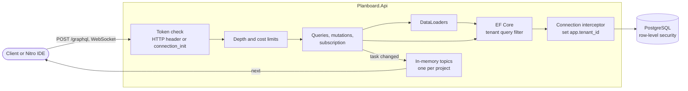

# Planboard

Planboard is a multi-tenant project management API built with .NET 10, GraphQL (Hot Chocolate) and PostgreSQL. Companies share the same tables, and every company sees only its own projects, tasks and people. I built it to cover what makes a shared GraphQL API hard: keeping tenants apart even when a query forgets a filter, nested fields that turn into hundreds of SQL queries, clients that can ask for unlimited work in one request, and live updates over WebSockets that must respect the same rules.

[](https://github.com/hmzckd/planboard/actions/workflows/ci.yml)

## What it includes

- Three seeded tenants (Acme, Globex, Initech) with 20 projects and 2,000 tasks, sharing one set of tables
- Two tenant locks: an EF Core global query filter and PostgreSQL row-level security that fails closed
- API token authentication; tokens are stored only as SHA-256 hashes behind a database function
- Owner, member and viewer roles, with field-level rules such as who can read a user's email
- DataLoaders that turn a 632-query nested request into 3 SQL commands, with a test that counts them
- Relay global IDs, `node(id)` and keyset cursor pagination (at most 50 items per page)
- Mutations that return typed errors (`NotFoundError`, `ValidationError`, ...) in their payload
- Depth and cost limits that reject an expensive query before it reaches the database
- A `taskChanged` subscription over WebSockets, authenticated in `connection_init` and checked per tenant
- A schema snapshot test, integration tests on a real PostgreSQL with Testcontainers, and CI

## How it fits together



Every request runs as the database role `planboard_app`, which cannot bypass row-level security. Before EF Core uses a connection, the interceptor writes the caller's tenant id into the connection, and every table policy compares rows with it. If the id is missing, the policies match nothing.

## How tenants are kept apart

| Layer | What it does | What happens if it is missing |
| --- | --- | --- |
| EF Core global query filter | Adds `WHERE tenant_id = @tenant` to every query | Row-level security still returns only the caller's rows (tested by removing the filter) |
| PostgreSQL row-level security | `tenant_id = current_tenant_id()` on every table, `FORCE` on, app role without `BYPASSRLS` | The filter still scopes ordinary queries, but raw SQL would not be protected |
| Composite foreign keys | `(tenant_id, project_id)` → `projects (tenant_id, id)` | A task could point to another tenant's project |
| Connection interceptor | Sets `app.tenant_id` on every connection open, an empty value when there is no user | A pooled connection could keep the previous tenant (tested) |
| Subscription check | A project of another tenant is not found, and events carry only ids | A listener could receive another tenant's changes |

## N+1 in numbers

Loading Acme's 7 projects with all 700 tasks and each task's assignee, counted by an EF Core command interceptor (the `X-Sql-Command-Count` response header in development):

| Version | SQL commands |
| --- | --- |
| One resolver per field, straight to EF Core | 632 |
| DataLoaders (`TasksByProjectId`, `UserById`) | 3 |

Lists are paged now, and `NPlusOneTests` checks that the paged version of this query, and a deeper one with labels, comments and their authors, still runs one SQL command per DataLoader batch instead of one per row.

## Stack

| Area | Technology |
| --- | --- |
| API | ASP.NET Core 10 on .NET 10, Hot Chocolate 16 (GraphQL, source generator) |
| Database | PostgreSQL 18, EF Core 10 with Npgsql, EF Core migrations |
| Data loading | GreenDonut DataLoaders, keyset paging with `GreenDonut.Data.EntityFramework` |
| Realtime | `graphql-transport-ws` subscriptions, in-memory topics |
| Tests | xUnit v3, WebApplicationFactory, Testcontainers |
| CI | GitHub Actions |

## Repository layout

```text
.
├── src/Planboard.Api/
│   ├── Auth/           token authentication, roles and policies, WebSocket token check
│   ├── Data/           entities, DbContext, migrations, tenant interceptor, seed data
│   ├── Diagnostics/    SQL command counter
│   ├── Domain/         business rules and typed errors
│   └── GraphQL/        queries, mutations, subscription, object types, DataLoaders
├── tests/Planboard.Tests/   integration tests against a real PostgreSQL
├── docker/postgres/init.sql the owner and app database roles
├── docs/adr/                architecture decision records
├── schema.graphql           the public schema, checked by a snapshot test
├── GLOSSARY.md              terms used in the code
├── Dockerfile
└── compose.yaml             PostgreSQL, and the API with the app profile
```

## Run with Docker

Docker Desktop is the only requirement:

```powershell
docker compose --profile app up --build
```

The first build takes a few minutes. Then open the Nitro GraphQL IDE at `http://localhost:5080/graphql`.

| What | Where |
| --- | --- |
| GraphQL API and Nitro IDE | `http://localhost:5080/graphql` |
| Health check | `http://localhost:5080/health` |
| PostgreSQL | `localhost:5436` (user and password `postgres`) |

The container runs in the `Development` environment so that the IDE, introspection and the seed data are on. A real deployment leaves `ASPNETCORE_ENVIRONMENT` unset, which turns all three off.

`docker compose --profile app down -v` stops everything and deletes the data.

### Seed tokens

In Nitro, add the header `Authorization: Bearer <token>` under HTTP Headers.

| Token | User | Tenant | Role |
| --- | --- | --- | --- |
| `pb_dev_alice` | Alice | Acme | Owner |
| `pb_dev_bob` | Bob | Acme | Member |
| `pb_dev_dave` | Dave | Acme | Viewer |
| `pb_dev_grace` | Grace | Globex | Owner |
| `pb_dev_heidi` | Heidi | Globex | Member |
| `pb_dev_peter` | Peter | Initech | Owner |

### Try it

Who am I, and what can I see:

```graphql
{
  me { displayName role tenant { name } }
  projects(first: 5) {
    nodes {
      id
      name
      tasks(first: 3, status: TODO) { nodes { id title assignee { displayName } } }
    }
  }
}
```

The same query with `pb_dev_grace` returns Globex's projects. Asking `node(id: ...)` with an Acme id as Grace returns `null`.

Create a task and get a typed error back:

```graphql
mutation {
  createTask(input: { projectId: "<project id>", title: "" }) {
    task { id title }
    errors { __typename ... on Error { message } }
  }
}
```

Watch a project live. Run this as `pb_dev_dave` in one Nitro tab:

```graphql
subscription {
  taskChanged(projectId: "<project id>") {
    kind
    task { title status }
    changedBy { displayName }
  }
}
```

Then, as `pb_dev_bob` in a second tab, change a task in that project with `updateTask`, `changeTaskStatus`, `assignTask` or `addComment`. The first tab shows the change and who made it.

From PowerShell:

```powershell
$headers = @{ Authorization = "Bearer pb_dev_alice" }
$body = '{"query":"{ me { displayName tenant { name } } }"}'
Invoke-RestMethod -Method Post -Uri http://localhost:5080/graphql -Headers $headers -ContentType "application/json" -Body $body | ConvertTo-Json -Depth 5
```

## Develop locally

With the .NET 10 SDK installed, start only PostgreSQL and run the API from the source:

```powershell
docker compose up -d
dotnet run --project src/Planboard.Api
```

The API listens on `http://localhost:5080`, applies migrations and seeds the three tenants on start. Migrations run as `planboard_owner`; requests run as `planboard_app`.

## Checks

The tests need the .NET 10 SDK and a running Docker, because they start their own PostgreSQL container:

```powershell
dotnet test
```

They cover tenant isolation (queries, `node(id)`, mutations, the subscription and pooled connections), row-level security without the EF Core filter, roles, SQL command counts, pagination, query limits and the schema snapshot. After a deliberate schema change, refresh the snapshot with `$env:UPDATE_SCHEMA = "1"; dotnet test; Remove-Item Env:UPDATE_SCHEMA`.

## API overview

Everything goes through `POST /graphql` (and a WebSocket on the same path for the subscription). The full schema is in [`schema.graphql`](schema.graphql).

| Operation | Purpose | Role |
| --- | --- | --- |
| `me` | The calling user and their tenant | any |
| `projects(first, after)` | The tenant's projects; each has `tasks(status, first, after)` | any |
| `project(id)`, `node(id)`, `nodes(ids)` | Fetch by global ID | any |
| `members(first, after)` | The tenant's users; `email` only for owners and the user themselves | any |
| `createProject` | Create a project with a unique name in the tenant | owner, member |
| `createTask`, `updateTask` | Create or edit a task | owner, member |
| `changeTaskStatus` | `TODO` → `IN_PROGRESS` → `DONE`, and back one step | owner, member |
| `assignTask` | Assign a task to a user of the tenant, or unassign it | owner, member |
| `addComment` | Comment on a task | owner, member |
| `inviteMember` | Create a user and return their API token once | owner |
| `changeMemberRole` | Change a role; the last owner cannot be demoted | owner |
| `taskChanged(projectId)` | Subscription: one event per task change in a project | any |

Expected failures (not found, validation, an invalid status change, a duplicate name or email) are returned in the mutation's `errors` list with HTTP 200. Missing permissions return `AUTH_NOT_AUTHORIZED` in the top-level `errors`. Queries deeper than 8 levels or above a cost of 10,000 are rejected with HTTP 400 before any SQL runs; send `GraphQL-Cost: report` to see a query's cost.

## Design decisions

Each decision has a short record in [`docs/adr/`](docs/adr/) with its reasons and consequences.

| ADR | Decision |
| --- | --- |
| [0001](docs/adr/0001-use-graphql-with-hot-chocolate.md) | GraphQL with Hot Chocolate instead of REST |
| [0002](docs/adr/0002-share-tables-and-scope-rows-by-tenant-id.md) | All tenants share tables, and every row carries a `tenant_id` |
| [0003](docs/adr/0003-enforce-tenant-isolation-with-postgres-row-level-security.md) | PostgreSQL row-level security as a second lock behind the EF Core filter |
| [0004](docs/adr/0004-batch-nested-fields-with-dataloaders.md) | Every nested field loads through a DataLoader |
| [0005](docs/adr/0005-limit-query-depth-and-cost.md) | Depth 8 and a cost budget measured from real queries; no introspection outside development |
| [0006](docs/adr/0006-in-memory-subscriptions-with-the-token-in-connection-init.md) | In-memory subscriptions, with the token sent in `connection_init` |

## Roadmap

- Subscriptions across several API instances with PostgreSQL `LISTEN/NOTIFY`
- Persisted queries, so production clients can only run known operations
- Users who belong to more than one tenant
- Deleting and archiving projects and tasks
- Building the Docker image in CI
